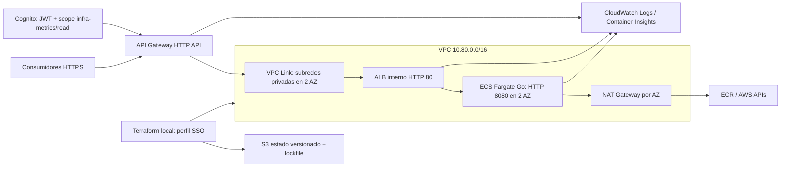

# Arquitectura implementada en Terraform

Este diagrama describe código; no acredita recursos desplegados. Cognito, ECR y CloudWatch son servicios regionales fuera de la VPC. Bootstrap administra S3 de estado, ECR y un presupuesto de cuenta; el stack principal consulta ese ECR existente.

La entrada pública usa TLS del dominio execute-api de AWS. No requiere dominio propio ni ACM para este endpoint. ACM y dominio personalizado quedan fuera del laboratorio inicial. Dentro de la VPC el enlace usa HTTP; si se exige cifrado extremo a extremo, añadir listener HTTPS, certificado y verificación TLS de la integración.

Security groups permiten exclusivamente Link→ALB:80 y ALB→tareas:8080. Las tareas no tienen IPv4 pública; solo permiten salida HTTPS, con NAT independiente por AZ para ECR y logs. El ALB vive en dos subredes privadas. Las subredes públicas alojan exclusivamente los NAT.

Cuatro rutas de negocio GET exigen JWT y scope infra-metrics/read. /health/ready es pública y no entrega datos internos. /docs, /openapi.json y /health/live son locales/internas, no rutas públicas de Gateway. Los errores generados por Gateway (401/403/429) tienen formato AWS; los errores del backend conservan error.code y error.message.

Cognito permite altas administrativas, OAuth authorization code con PKCE y cliente público sin secreto. No se crean usuarios ni contraseñas en Terraform. La única callback inicial es http://localhost:8085/callback; configurar una callback real al integrar consumidores. La API entrega fixtures, no telemetría AWS.

ECS usa Linux/X86_64: publicar imagen linux/amd64. Dos tareas deseadas, máximo cuatro y throttling inicial 100 RPS/200 burst limitan el laboratorio, **no demuestran ni habilitan 10.000 RPS**. Para esa meta se requieren cuotas verificadas, dimensionamiento, autorización de carga y mediciones con margen N-1 AZ.

Hay circuit breaker, probes y espera de estabilidad; no cubren regresiones funcionales silenciosas. CloudWatch tiene logs y alarmas 5xx de ALB, targets y Gateway. Sin alarm_topic_arn no hay destino de notificaciones. Logs estructurados de aplicación, tracing y alarmas SLO quedan pendientes.

HTTP API no incluye WAF directo en este diseño. No se aprovisiona un secret si no se necesita. Task role sin permisos adicionales; execution role para imagen/logs y secret opcional. Los roles de GitHub/OIDC y la separación del rol de infraestructura se completarán cuando exista repositorio. Actualmente el despliegue inicial previsto usa el perfil humano SSO devops-challenge; no el usuario root.
