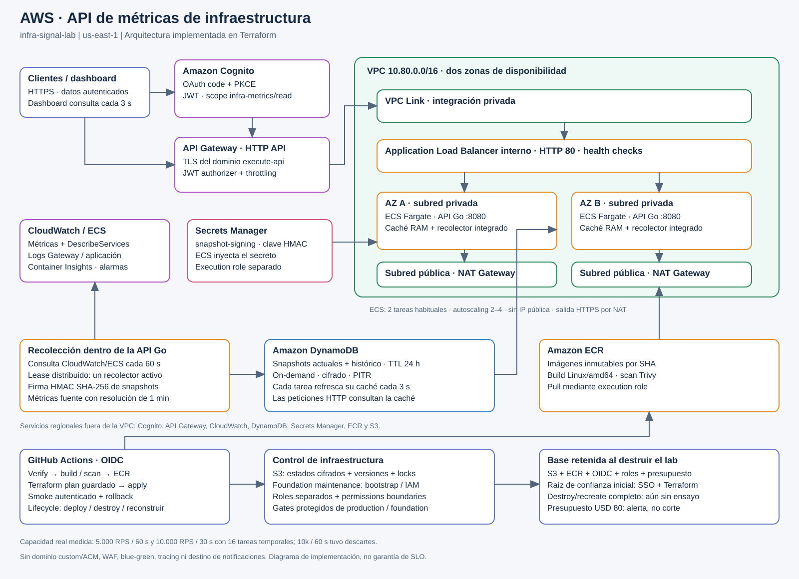
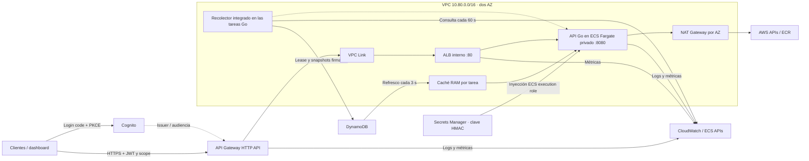

# Arquitectura AWS implementada

[Descargar SVG](architecture.svg) · [Descargar PNG](architecture.png). Corresponde al Terraform del laboratorio `infra-signal-lab` en `us-east-1`; los resultados de carga se limitan a las versiones y condiciones documentadas.

## Tráfico y datos

El recolector forma parte del proceso Go; no hay una Lambda ni un servicio recolector adicional. Un lease DynamoDB coordina la recolección entre tareas. Consulta métricas CloudWatch y despliegues ECS cada minuto, firma snapshots con HMAC SHA-256 y persiste el actual y su historial en DynamoDB. Cada tarea refresca su caché cada tres segundos; las solicitudes HTTP leen RAM. El dashboard consulta la API cada tres segundos, pero la resolución de las métricas fuente es de un minuto. No se inventan valores cuando AWS no entrega muestras. Ver [telemetría](telemetry.md).

DynamoDB usa capacidad bajo demanda, cifrado, PITR y TTL de 24 horas. Secrets Manager contiene la clave real de firma, inyectada en ECS por el execution role; el task role consulta las fuentes y la tabla. Los servicios regionales del diagrama están fuera de las subredes de la VPC.

## Red y seguridad

El dominio AWS execute-api proporciona HTTPS público, sin dominio propio ni recurso ACM. Las seis rutas de negocio GET requieren JWT Cognito y scope `infra-metrics/read`; `/health/ready` y los assets del dashboard son públicos, sin datos internos. Los errores de Gateway tienen formato AWS; el backend mantiene `error.code` y `error.message`.

El ALB interno se extiende por dos subredes privadas. Los security groups restringen Link→ALB:80 y ALB→tareas:8080. Las tareas no tienen IP pública y salen a AWS por HTTPS mediante un NAT por AZ, ubicado en la correspondiente subred pública. El tráfico de aplicación dentro de la VPC usa HTTP. La API Go ejecuta una imagen Linux/amd64, no-root y con filesystem de solo lectura.

El perfil habitual mantiene dos tareas, autoscaling entre dos y cuatro por CPU/requests y throttling de 100 RPS con burst 200. El ensayo temporal usó 16 tareas y límites mayores, luego restaurados. La versión real demostró 5k RPS/60 s y 10k RPS/30 s; el intento real de 10k/60 s tuvo descartes. El resultado histórico de fixtures se conserva separado. Ver [mediciones reales](telemetry-capacity-results.md).

## Entrega y control

GitHub Actions verifica Go, helpers, Docker/Trivy y Terraform. En push a main, con `LAB_AUTODEPLOY_ENABLED=true`, publica una imagen SHA inmutable en ECR y aplica el plan Terraform guardado después del gate del environment `production`. Espera estabilidad ECS y ejecuta smoke autenticado, persistencia y dos recolecciones sucesivas. Las credenciales son temporales mediante OIDC; no hay access keys permanentes.

**Lab lifecycle** centraliza plan, deploy, rollback, destroy-plan y destroy. **Foundation maintenance** mantiene bootstrap e identidad con su propio rol y gate. Los estados S3 están separados, cifrados, versionados y bloqueados; las mutaciones comparten una cola de concurrencia. Roles separados y permissions boundaries limitan el alcance de CI y runtime.

La base S3/ECR/OIDC/roles/presupuesto se retiene al destruir la aplicación para poder reconstruirla desde Actions. Instalar o modificar la raíz de confianza `iac/control` requiere SSO externo y Terraform; el rol foundation no puede administrarse a sí mismo. El ciclo destructivo completo aún no se ha ensayado: un destroy-plan exitoso no demuestra borrado y reconstrucción. Ver [alcance del lifecycle](lifecycle.md) y [roles](iam-oidc.md).

Evidencias: [deploy y smoke exitosos](https://github.com/Camilo2299/MeliChallenge/actions/runs/39001245527), [mantenimiento de foundation](https://github.com/Camilo2299/MeliChallenge/actions/runs/39000421161) y [destroy-plan sin aplicar](https://github.com/Camilo2299/MeliChallenge/actions/runs/38999184291).

## Límites explícitos

CloudWatch conserva logs, métricas, Container Insights y alarmas 5xx de Gateway/ALB/targets. No hay destino de notificaciones, tracing distribuido ni ALB access logs. ECS usa rolling deployment y circuit breaker; no blue/green ni canary. No hay WAF ni dominio custom/ACM. Solo está desplegado `lab`; los environments de GitHub no representan otros entornos AWS.

Quedan sin demostrar soak, pérdida de AZ bajo carga y destrucción/recreación completa. La recuperación histórica de una tarea y el rollback con imagen idéntica tienen alcance limitado. [Checklist del PDF](audit.md) y [correspondencia con el dibujo inicial](architecture-compliance.md).
