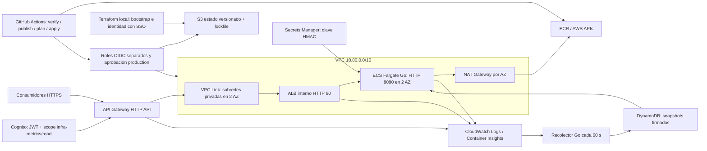

# Arquitectura implementada en Terraform

Este diagrama corresponde al laboratorio desplegado; ver [evidencia de despliegue y pruebas](deployment-progress.md). Cognito, ECR y CloudWatch son servicios regionales fuera de la VPC. Bootstrap administra S3 de estado, ECR y un presupuesto de cuenta; el stack principal consulta ese ECR existente.

La entrada pública usa TLS del dominio execute-api de AWS. No requiere dominio propio ni ACM para este endpoint. ACM y dominio personalizado quedan fuera del laboratorio inicial. Dentro de la VPC el enlace usa HTTP; si se exige cifrado extremo a extremo, añadir listener HTTPS, certificado y verificación TLS de la integración.

Security groups permiten exclusivamente Link→ALB:80 y ALB→tareas:8080. Las tareas no tienen IPv4 pública; solo permiten salida HTTPS, con NAT independiente por AZ para ECR y logs. El ALB vive en dos subredes privadas. Las subredes públicas alojan exclusivamente los NAT.

Seis rutas de negocio GET exigen JWT y scope infra-metrics/read. /health/ready es pública y no entrega datos internos. /docs, /openapi.json y /health/live son locales/internas, no rutas públicas de Gateway. Los errores generados por Gateway (401/403/429) tienen formato AWS; los errores del backend conservan error.code y error.message.

Cognito permite altas administrativas, OAuth authorization code con PKCE y cliente público sin secreto. No se crean usuarios ni contraseñas en Terraform. Se conservan la callback local PKCE y la callback HTTPS /dashboard. La nueva versión configura CloudWatch/ECS como fuentes y DynamoDB como persistencia; ver telemetry.md y su estado de validación.

ECS usa Linux/X86_64: publicar imagen linux/amd64. Dos tareas deseadas, máximo cuatro y throttling inicial 100 RPS/200 burst limitan el laboratorio, **no habilitan permanentemente 10.000 RPS**; un perfil temporal de 16 tareas validó ese pico por 60 s (ver capacity-results.md). Para esa meta se requieren cuotas verificadas, dimensionamiento, autorización de carga y mediciones con margen N-1 AZ.

Hay circuit breaker, probes y espera de estabilidad; no cubren regresiones funcionales silenciosas. CloudWatch tiene logs y alarmas 5xx de ALB, targets y Gateway. Sin alarm_topic_arn no hay destino de notificaciones. Logs estructurados de aplicación, tracing y alarmas SLO quedan pendientes.

HTTP API no incluye WAF directo en este diseño. Secrets Manager custodia la clave HMAC de snapshots, inyectada por el execution role. El task role consulta CloudWatch/ECS y lee/escribe la tabla DynamoDB. GitHub Actions usa tres roles OIDC separados para publicar, planificar y aplicar, ligados al repositorio y al entorno. El perfil humano SSO devops-challenge administra bootstrap e identidad; no se usa root. El pipeline publica en ECR, guarda un plan revisable y aplica ese mismo plan tras la aprobación de production. Solo lab está desplegado; staging/production independientes quedan como evolución.

Correspondencia detallada con el diagrama inicial: [architecture-compliance.md](architecture-compliance.md). Intento de capacidad posterior: [capacity-results.md](capacity-results.md); el perfil habitual conserva límites de costo y no queda abierto a 10k RPS.
