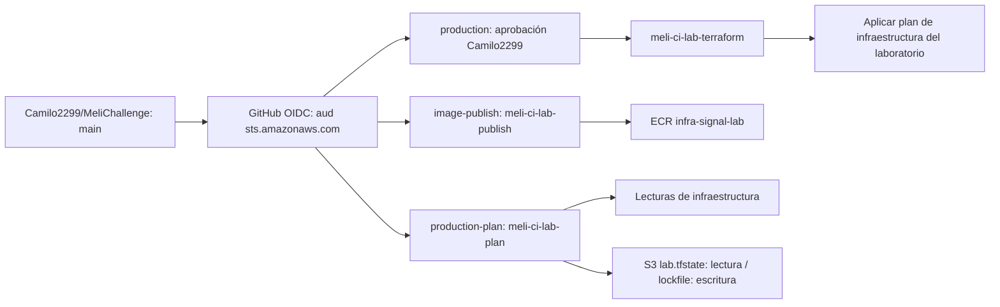

# Identidades de GitHub Actions y AWS

## Diseño



Los nombres de entornos production-plan/production se conservaron del workflow, pero TF_ENVIRONMENT=lab: no representan una plataforma productiva ya desplegada. Cada entorno permite únicamente la rama main. `production` exige revisión de Camilo2299; se permite autoaprobación porque el laboratorio tiene un único responsable. No equivale a revisión independiente por dos personas. Se deshabilitó bypass administrativo de las protecciones del entorno.

Las trust policies usan StringEquals exacto para `aud=sts.amazonaws.com` y `sub=repo:Camilo2299/MeliChallenge:environment:NOMBRE`. No hay wildcard en repositorio o entorno. Las sesiones duran como máximo una hora. El proveedor OIDC es global en la cuenta; el módulo admite reutilizar un proveedor existente para evitar duplicados.

## Permisos

- Publicación: token ECR y pull/push/describe exclusivamente del repositorio infra-signal-lab. Sin ECS ni acceso al estado.
- Plan: lecturas del stack y del objeto infra-signal/lab.tfstate; escritura/eliminación únicamente de su .tflock. No puede aplicar infraestructura ni escribir el objeto de estado.
- Terraform: base de permisos para el plan inicial del laboratorio y actualización del servicio/task definition. PassRole solo permite infra-signal-lab-execution y infra-signal-lab-task hacia ecs-tasks.amazonaws.com. No puede administrar sus propios roles OIDC ni el estado identity.tfstate; la administración de identidad queda en la sesión humana SSO.
- IAM de aplicación: crear/leer/etiquetar solo los dos roles ECS; adjuntar únicamente AmazonECSTaskExecutionRolePolicy al execution role. No hay AdministratorAccess, iam:* ni PassRole global. La API no hace llamadas AWS y su task role no necesita permisos adicionales.
- Backend: los roles de CI solo acceden a la key del stack lab y su lockfile. No se permite leer/escribir el estado bootstrap ni el de identidad. ListBucket permite las keys concretas y el prefijo de descubrimiento de workspaces env:/; no da acceso a sus contenidos.

Las políticas se separan en documentos administrados de menos de 6144 bytes. No se usa una política inline que exceda el límite agregado del rol.

## Generación y revisión

La base se obtuvo con IAM Policy Autopilot 0.3.0 desde un plan Terraform real, **sin aplicar la infraestructura**:

```bash
umask 077
terraform -chdir=iac plan -var=image_tag=RELEASE -out=permissions.tfplan
terraform -chdir=iac show -json permissions.tfplan > /tmp/meli-permissions-plan.json
uvx iam-policy-autopilot@latest generate-policies /tmp/meli-permissions-plan.json \
  --region us-east-1 --account 026249143093 --pretty
```

No usar --upload-policies. El JSON/plan contienen potencialmente datos sensibles: se generaron con permisos privados y se retiraron después de generar la base. La salida automática **no era mínimo privilegio**: contenía PassRole global, recursos IAM ajenos y permisos auxiliares de OAM. Se eliminaron y se acotaron ARNs/namespaces; se consultó la referencia oficial de autorización para verificar acciones y alcance de recursos. Se añadieron lecturas de data sources, acceso S3 de backend y operaciones de actualización de ECS.

Las seis políticas iniciales pasaron `aws accessanalyzer validate-policy --policy-type IDENTITY_POLICY` sin hallazgos. Esa validación comprueba estructura y buenas prácticas, **no garantiza permisos suficientes ni aislamiento completo**. `cicd/check_iam.py` verifica tamaños, acciones sin wildcard, plan sin mutaciones de infraestructura, publisher solo ECR y PassRole acotado. Las pruebas Terraform simuladas verifican las trust policies exactas.

## Alcance y límites que deben revisarse después del primer despliegue

Muchos IDs de red, API Gateway y Cognito no existen antes del primer apply. Parte de los permisos requiere ARNs regionales con wildcard de ID o Resource=* para APIs de lectura/creación. Las mutaciones de red existente exigen Project=infra-signal; las creaciones se restringen por cuenta/región y las operaciones con nombres conocidos por namespace. API Gateway y algunos IDs Cognito/autoscaling requieren una revisión adicional con los ARNs reales después del despliegue; no afirmar aislamiento perfecto por proyecto para todas las APIs.

La política se deriva del plan inicial, no concede un catálogo general de administración/destroy ni garantiza todos los cambios futuros. Si un plan posterior necesita acciones adicionales, regenerar y revisar los permisos en este stack humano. No añadir permisos globales para resolver AccessDenied. Para activar secret_arn, revisar IAM específico; este laboratorio no lo utiliza.

CloudTrail/alertas dedicadas para cambios IAM del pipeline no se aprovisionaron aquí. Recomendación antes de operación real: auditoría de sesiones OIDC, trail cifrado y validado, alertas de cambios de permisos y revisión independiente del plan. Los roles no crean esas protecciones automáticamente.

## Estado y operación

- Stack: iac/identity; módulo reutilizable: iac/modules/iam.
- Backend: bucket infra-signal-lab-tfstate-026249143093-us-east-1, key infra-signal/identity.tfstate, encrypt y use_lockfile habilitados.
- Aplicar **únicamente tras aprobar identity.tfplan**. Esta entrega prepara el plan; no acredita que los roles estén creados.
- Variables GitHub configuradas con nombres/ARN previstos: AWS_REGION, AWS_ACCOUNT_ID, TF_ENVIRONMENT, TF_STATE_BUCKET, ECR_REPOSITORY_URL, AWS_PUBLISH_ROLE_ARN, AWS_PLAN_ROLE_ARN y AWS_DEPLOY_ROLE_ARN. Son configuración pública, no claves.
- `Verify AWS OIDC` prueba STS/ECR sin crear infraestructura. La prueba del rol Terraform usa el entorno protegido y requiere la aprobación humana.
- `Verify Plan and Deploy` sigue manual para despliegues. Publica la imagen con el rol publisher, genera el plan con el rol de lectura y aplica el mismo artefacto con el rol Terraform tras aprobación.

No disparar deploy=true para probar autenticación. Un workflow de despliegue sí puede crear recursos facturables.
