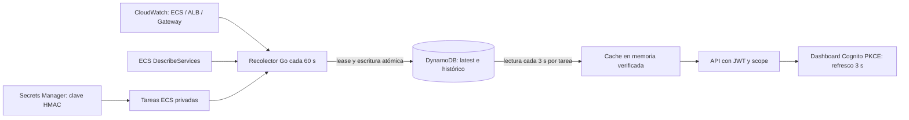

# Telemetría real de la infraestructura

La API tiene dos modos: sin `METRICS_TABLE` conserva los fixtures para desarrollo local; en AWS, Terraform configura obligatoriamente la tabla y el runtime consulta datos reales. No existe fallback de AWS a fixtures cuando falla la fuente.

## Datos y semántica

- CPU y memoria: `AWS/ECS`, dimensiones del clúster y servicio desplegados.
- Tráfico y latencia p95: `AWS/ApplicationELB` y `AWS/ApiGateway`.
- Errores: ALB 5xx, targets 5xx, Gateway 4xx y 5xx.
- Estado del servicio: tareas deseadas, ejecutándose y pendientes; referencia real de task definition.
- Despliegues: revisiones que ECS devuelve actualmente, con IDs y rollout. No representa un histórico completo de todos los releases.

El periodo de CloudWatch es 60 s y las series consultadas abarcan 15 minutos completos. La fecha de recolección **no sustituye** la fecha de cada muestra. No se inventa disponibilidad de 24 h, TPS sin ventana, ni ceros cuando faltan datos. Una métrica sin muestras usa `points: []` y `status: no_data`.

Un snapshot de más de 180 s se marca desactualizado en el resumen y la vista; readiness falla si supera 300 s. Las tarjetas señalan muestras de más de cinco minutos. Si falla CloudWatch/ECS, no se persiste un snapshot nuevo; se conserva el último verificado para diagnóstico. Liveness no depende de AWS.

## Persistencia y coordinación

DynamoDB usa claves `pk = nombre del servicio` y `sk = LATEST | LOCK | SNAP#timestamp`. Un lease condicional de 55 s evita que las réplicas recolecten simultáneamente; la recolección tiene deadline de 40 s y se intenta cada 60 s. No constituye un sistema de exclusión para escritores ajenos al servicio. Último estado e histórico se escriben en una transacción. La API responde desde memoria, sin una llamada a DynamoDB/CloudWatch por petición.

Cada tarea refresca el estado cada tres segundos y el histórico cada minuto. El histórico expone como máximo los últimos 30 snapshots; los registros vencen a las 24 h mediante TTL. El TTL de DynamoDB elimina de forma asíncrona: la API filtra registros vencidos. Cifrado, PITR y protección de borrado están configurados. No se requieren JOINs ni conexiones SQL, por lo que se elige DynamoDB on-demand frente a RDS. CloudWatch sigue siendo la fuente del histórico de métricas de mayor duración.

## Secretos y permisos

Secrets Manager custodia una clave aleatoria de 48 caracteres usada para HMAC-SHA256 sobre el payload persistido. ECS la inyecta al arrancar, usando exclusivamente el execution role. La API rechaza snapshots cuya firma no coincide; nunca devuelve la clave o firma en las respuestas. La firma detecta modificaciones por escritores sin acceso a la clave, no protege frente a una tarea comprometida que ya la posee. El task role accede únicamente a la tabla y servicio configurados; `GetMetricData` permite consultar métricas de la cuenta. No hay claves estáticas de AWS ni contraseña de base de datos.

El baseline IAM se generó con `iam-policy-autopilot generate-policies api/telemetry.go --region us-east-1 --account 026249143093 --service-hints cloudwatch dynamodb ecs --pretty` y con el plan JSON. Se redujeron permisos inferidos que no se usan (replicación, borrados, KMS cliente) y se acotaron ARNs. Las transacciones Put requieren `dynamodb:PutItem`; no existe una acción IAM llamada `dynamodb:TransactWriteItems`.

La versión del secreto se crea con Terraform mediante generación efímera y `secret_string_wo`: la clave no se guarda en el plan ni en el estado. No hay outputs con la clave. El contador `secret_string_wo_version = 1` evita rotación accidental por la generación aleatoria de otro plan. Rotar requiere procedimiento coordinado: una nueva clave invalida snapshots anteriores hasta recolectar con la nueva versión y renovar todas las tareas. No se ha implementado rotación automática ni doble clave.

## Consulta y visualización

| Ruta GET | Contenido |
|---|---|
| `/v1/services` | Servicio real desplegado; filtro environment=lab/staging/production |
| `/v1/services/{service_id}` | Estado y tareas de ese servicio |
| `/v1/deployments` | Despliegues actuales de ECS; filtro service_id |
| `/v1/summary` | Estado general y frescura del snapshot |
| `/v1/metrics` | Snapshot real con las diez series de CloudWatch |
| `/v1/metrics/history` | Hasta 30 snapshots persistidos |
| `/dashboard` | Vista HTML pública sin datos hasta iniciar sesión |

Las seis rutas de negocio requieren JWT y scope `infra-metrics/read`. Los assets y la configuración pública del dashboard no contienen métricas ni secretos. El login usa code + PKCE y valida state; el access token queda en memoria del navegador. Solo el verifier y state efímeros se conservan en sessionStorage durante el redirect. Recargar la página requiere iniciar sesión de nuevo; la sesión de Cognito puede agilizarlo. No hay refresh token persistido.

## Costos y validación

No se añaden tareas ECS ni instancias RDS. La ampliación consume un secreto, almacenamiento/PITR y lecturas/escrituras DynamoDB, y diez métricas consultadas por minuto en CloudWatch. A dos tareas son unas 57.600 lecturas GetItem/día, más queries de histórico, y aproximadamente 1.440 recolecciones/día. El costo depende del tamaño de snapshot y de precios regionales, además de la infraestructura base que continúa encendida. No se debe interpretar el crédito o el presupuesto como un apagado automático.

Los resultados anteriores de 10.000 RPS corresponden a la imagen con fixtures. No certifican automáticamente esta versión con persistencia y HMAC; requiere evidencia nueva. Las pruebas de Go cubren fuentes fallidas, firmas adulteradas, lease, frescura y rutas. La validación AWS se registra por separado una vez aplicada y consultada esta versión.

## Evidencia AWS de la versión real

Aplicación Terraform final: 11 recursos añadidos, tres actualizados y una sustitución de task definition (incluida en las altas/bajas). ECS quedó estable con dos tareas, sin pendientes, revisión `infra-signal-lab:6`, imagen `36d96bdbc65f57eaab94635b9bb0616c44e90519`. VPC y ALB existentes se conservaron. No se añadió cómputo permanente.

[Reporte real](evidence/real-telemetry.json): siete consultas de negocio autenticadas y los tres assets/configuración pública del dashboard devolvieron 200. CPU y memoria contienen muestras reales; ALB sin muestras de errores conserva series vacías. Se observaron recolecciones distintas a las 02:21:08 y 02:22:08 UTC del 17 de octubre (21:21 y 21:22 del 16 de octubre en Bogotá). El registro LATEST de DynamoDB coincide con el origen real y tiene firma. Se comprobó la referencia del secreto en ECS y su metadata, sin leer ni registrar su valor. También se verificó que la clave no está en los campos del estado Terraform.

Carga acotada de la imagen real: objetivo 30 RPS por 60 s, 1.801 respuestas válidas, 29,97 RPS observados contando cierre, p95 161,007 ms, cero errores y cero iteraciones descartadas. La repetición del pico para esta imagen se registra por separado en el plan telemetry-capacity-plan.md y en sus evidencias, sin sustituir el resultado acotado anterior. Las consultas de prueba usaron un cliente M2M temporal; su propagación de audiencia produjo reintentos previos a la medición, registrados en el reporte. Ese cliente fue eliminado y la audiencia humana original restaurada.

La comprobación automatizada valida API, persistencia y assets; no sustituye una prueba manual del flujo visual de login en un navegador. El dashboard usa el mismo cliente Cognito con la nueva callback HTTPS permitida.

## Capacidad de esta imagen

Se completaron 5.000 RPS/60 s y una repetición de 10.000 RPS/30 s contra /v1/metrics. El primer intento de 10k/60 s falló por descartes y no se aprueba. Ver [resultados completos y límites](telemetry-capacity-results.md). No se extrapola el ensayo corto a un minuto ni a carga sostenida.
